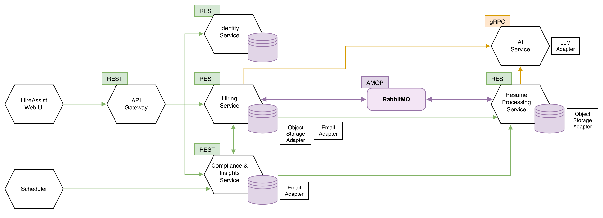

# Architecture Diagram — version 2

*Microservice Design with Collaborations.* This page is the diagram half of the deliverable; the
operations half is the [Service–Operations–Collaborators table](SERVICE-OPERATIONS-COLLABORATORS.md).
The two describe the same services and must agree — the table lists every operation, this page
shows who calls whom.

This is the second version of the architecture, revised for the progress checkpoint. It shows
every component the three core business use cases need — **UC-1** create a job opening, **UC-2**
batch-screen resumes, **UC-3** generate interview questions — and the collaborations between them.
What changed from version 1 is the **message broker**: the screening handover between Hiring and
Resume Processing now runs over RabbitMQ (ADR-013), and the REST link between them carries only
profile reads.

*Version 1's layout and notation, with the broker added. Diagram as code:
`diagrams/sw-arch-v2.svg`, rendered with `rsvg-convert -z 2 docs/diagrams/sw-arch-v2.svg -o
docs/diagrams/sw-arch-v2.png`. Green arrows are REST, orange gRPC, purple RabbitMQ; a cylinder
beside a service is its private store, and a plain box an adapter to an external system. Version
1, drawn in draw.io with its source outside this repository, is kept as
`diagrams/sw-arch.drawio.png`. This page and the
[Service–Operations–Collaborators table](SERVICE-OPERATIONS-COLLABORATORS.md) must agree with
what it shows.*

---

## How to read it

- **An arrow `A → B` means "A calls B."** Responses are not drawn. Where a caller uses what it
  got from one call to make another, both arrows leave the caller — `A → B` and `A → C` — never a
  chain `A → B → C`, which would mean B calls C.
- **A service's private store is drawn beside it**, and it is that service's alone. No service
  reads another service's store; it calls the owning service's operation instead.
- **Arrows are not labelled with operations** — the table lists them. **Every arrow is REST over
  HTTP/JSON except the two into the AI Service, which are gRPC** (ADR-001, ADR-007), **and the
  screening handover between Hiring and Resume Processing, which runs over the RabbitMQ message
  broker** (ADR-013): Hiring publishes `screening.requested`, Resume Processing publishes
  `screening.completed`, and a REST call remains only for reading a candidate's profile.
- **An adapter box beside a service stands for an external system**, and for the fact that the
  service reaches it only through that adapter — object storage, the model provider, the email
  provider. The providers themselves are not drawn; the point the picture makes is that no
  domain logic touches a provider's API directly. The Service–Operations–Collaborators table
  names them.
- **The Scheduler is a trigger, not a service.** It is drawn because it is the only caller that
  does not arrive through the gateway, and because the erasure arrows out of Compliance &
  Insights would otherwise appear to fire from nowhere. How the timer is actually run is an open
  decision.
- **One deployment serves one customer company** (ADR-006), so everything in the picture is one
  company's instance and there is no tenant identity anywhere inside it.

## Actors

| Actor | Initiates | Reaches the system through |
|---|---|---|
| **Recruiter** | UC-1, UC-2, UC-3, UC-4 | the HireAssist Web UI → API Gateway |
| **Admin** | everything a Recruiter can, plus UC-5 (retention policy) and UC-6 (members and roles) | the same UI — Admin specialises Recruiter |
| **System Scheduler** | UC-4 staleness checks and UC-5 retention evaluation, on a timer | calls Compliance & Insights directly; no UI |
| *Candidate* | nothing — an indirect actor with no interface | their resume arrives as a file the Recruiter uploads; not drawn |

Signing in (UC-0) is not a business use case. A Guest signs in through the gateway and receives a
signed access token, which the gateway verifies itself on every later request without asking the
Identity Service (ADR-009). The Identity Service is drawn because the table lists it, but it is
connected only to the gateway — no other service calls it.

## Services and what each owns

| Service | Business capability | Use cases | Owns (private store) |
|---|---|---|---|
| **API Gateway** | Single entry point for user traffic: TLS, access-token verification, rate limiting, routing. The System Scheduler is an internal trigger and does not pass through it | — | nothing |
| **Identity Service** | Who may sign in and with which role | UC-0, UC-6 | PostgreSQL — members, their roles, sessions |
| **Hiring Service** | The hiring record: openings and criteria, screening batches and their results, shortlist decisions, interview guides | UC-1, UC-2, UC-3 | PostgreSQL — job openings, criteria, batches and per-entry status, scores and overrides, shortlist decisions; MongoDB — interview guides |
| **Resume Processing Service** | Turning one resume file into a scored candidate profile | UC-2 (per-resume work) | MongoDB — candidate identity and collection date, candidate profiles, parsed text, per-criterion scoring output and justifications (ADR-003 puts identity and the date in PostgreSQL; not yet done) |
| **Message broker (RabbitMQ)** | Carrying each resume to screening and its result back, with retry and dead-letter queues | UC-2 | the two screening queues and their retry and dead-letter queues — no domain data beyond ids, a file location and the criteria snapshot |
| **AI Service** | Every call to the language model, behind domain operations | UC-1, UC-2, UC-3 | nothing — prompts and the model credential only |
| **Compliance & Insights Service** | Retention enforcement and the pipeline dashboard | UC-4, UC-5 | PostgreSQL — retention policy, pipeline metrics, erasure and access audit logs |

Resume files themselves live in object storage, written by Hiring when a batch is uploaded and
read by Resume Processing when it works; neither database holds them.

## How the use cases run through it

This page stops at the picture: the components, what each owns, and who calls whom. The call
sequence behind every use case — actor, operation, responsible service, collaborators, and where
the data lands — is traced in **[OVERVIEW.md](OVERVIEW.md)**, including UC-0, UC-4, UC-5 and UC-6,
which the diagram touches but does not centre on.

They were traced in both places for a while, which is how the two drifted apart. One description
of runtime behaviour, one home for the diagram.

## Why REST everywhere except the AI Service and the screening handover

The reasoning behind one protocol was that boundaries are expensive to get wrong and protocols are
not. A boundary in the wrong place means re-owned data, a re-cut schema and a coordinated release;
a protocol in the wrong place is one adapter rewritten behind an interface that already exists. So
ADR-001 placed the boundaries first, ran them all over the protocol everybody on the team can
already debug, and named the AI Service call as the first place to revisit.

**That revisit has happened.** ADR-007 makes the AI Service gRPC, on three properties that separate
it from every other boundary: it carries the highest call volume in the system — once per resume,
not once per batch — its contract is the narrowest and least forgiving, and it is the boundary most
likely to be crossed by two different languages. Its operations are defined in a `.proto` and
both callers use a generated client, so a renamed field fails at build time rather than producing a
score with the justification quietly missing. The service is internal and never exposed through the
gateway, which is what makes a protocol nobody can read in a network tab acceptable here and
nowhere else.

**The message broker now carries the screening handover.** A spread of communication styles is
expected of us — at least one service reached by REST, one by RPC and one driven by a broker — and
ADR-013 completes the three. It puts RabbitMQ where it replaces the most hand-written code: the
per-resume handover between Hiring and Resume Processing, whose work table, retried callback and
retry schedule ADR-002 had built by hand. ADR-002's per-resume unit of work and failure rules
stand; only the crossing changed. The pipeline events Hiring pushes synchronously into
Compliance's write path were the other candidate, and remain the next place the broker would
earn its keep.
